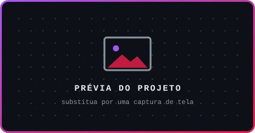

<!--
  ╔══════════════════════════════════════════════════════════════╗
  ║  README de perfil · kaikehttps/kaikehttps                    ║
  ║  Paleta: #0D1117 (base) · #A855F7 (roxo Gengar)              ║
  ║          #E11D48 (vermelho Shadow) · #E6EDF3 (texto)         ║
  ║          #3B82F6 (detalhes azuis) · #242938 (fundo badges)   ║
  ║                                                              ║
  ║  Áreas para editar: procure por "EDITAR" neste arquivo.      ║
  ╚══════════════════════════════════════════════════════════════╝
-->

<!-- ═══════════════════════════ CABEÇALHO ═══════════════════════════ -->

<table>
  <tr>
    <td align="center" width="28%">
      
    </td>
    <td align="center" width="44%">
      <h1>Kaike Ferreira Alves</h1>
      <b>Full Stack Developer</b>
        
      <!-- EDITAR: frase curta de apresentação -->
      <i>Construindo do pixel ao servidor, um commit de cada vez.</i>
    </td>
    <td align="center" width="28%">
      
    </td>
  </tr>
</table>

<!-- ═══════════════════════════ SOBRE MIM ═══════════════════════════ -->
<h2 align="center">Sobre mim</h2>

<!--
  EDITAR: escreva aqui sua apresentação pessoal.
  Sugestão: 2 a 4 linhas sobre quem você é, o que está estudando
  e o tipo de projeto que gosta de construir.
  Depois, apague a linha "Apresentação em construção" abaixo.
-->

  <i>Apresentação em construção.</i>

<!-- ═══════════════════════════ TECNOLOGIAS ═══════════════════════════
  Ícones grandes: skillicons.dev (https://skillicons.dev)
  Badges: Shields.io, fundo #242938 (mesmo tom dos ícones do skillicons)
  Badges sem logo na Simple Icons usam um SVG próprio embutido em base64
  (Zustand, Git Flow, Machine Learning, NLP e LLMs).
-->
<h2 align="center">Tecnologias</h2>

  Ferramentas e linguagens com as quais tenho contato.

<!-- Frontend -->
<h3 align="center">Frontend</h3>

  
  
  
  
  
  
  
  
  

<!-- Mobile -->
<h3 align="center">Mobile</h3>

  
  
  

<!-- Backend e APIs -->
<h3 align="center">Backend e APIs</h3>

  
  
  
  
   
  
  

<!-- Banco de dados e serviços -->
<h3 align="center">Banco de dados e serviços</h3>

  
  
  
  

<!-- Estado e gerenciamento de dados -->
<h3 align="center">Estado e gerenciamento de dados</h3>

  
   
  
  
  

<!-- Testes -->
<h3 align="center">Testes</h3>

  
   
  

<!-- DevOps e ferramentas -->
<h3 align="center">DevOps e ferramentas</h3>

  
  
  
   
  
  

<!-- Inteligência artificial -->
<h3 align="center">Inteligência artificial</h3>

  
  
  

<!-- Desenvolvimento de jogos -->
<h3 align="center">Desenvolvimento de jogos</h3>

  

<!-- ═══════════════════════════ PROJETOS ═══════════════════════════
  EDITAR: para cada card, troque:
    - assets/project-placeholder.svg → captura do projeto (ex.: assets/projetos/nome.png)
    - NOME_DO_PROJETO, DESCRICAO_CURTA
    - LINK_DO_REPOSITORIO e LINK_DA_DEMO (sem demo? apague o badge "Demo")
    - Badges TECNOLOGIA_X → use o mesmo formato da seção Tecnologias, ex.:
      https://img.shields.io/badge/React-242938?style=flat-square&logo=react&logoColor=61DAFB
-->
<h2 align="center">Projetos em destaque</h2>

<table>
  <tr>
    <!-- PROJETO 1 -->
    <td width="50%" valign="top" align="center">
      
      <h3>NOME_DO_PROJETO</h3>
      
DESCRICAO_CURTA

      

        
        
        
      

      
      
    </td>
    <!-- PROJETO 2 -->
    <td width="50%" valign="top" align="center">
      
      <h3>NOME_DO_PROJETO</h3>
      
DESCRICAO_CURTA

      

        
        
        
      

      
      
    </td>
  </tr>
  <tr>
    <!-- PROJETO 3 -->
    <td width="50%" valign="top" align="center">
      
      <h3>NOME_DO_PROJETO</h3>
      
DESCRICAO_CURTA

      

        
        
        
      

      
      
    </td>
    <!-- PROJETO 4 -->
    <td width="50%" valign="top" align="center">
      
      <h3>NOME_DO_PROJETO</h3>
      
DESCRICAO_CURTA

      

        
        
        
      

      
      
    </td>
  </tr>
</table>

<!-- ═══════════════════════════ ESTATÍSTICAS ═══════════════════════════
  Dados reais gerados em tempo real para o usuário kaikehttps.
  Cards: GitHub Readme Stats + GitHub Readme Streak Stats.
  Se um serviço cair, o texto alternativo aparece no lugar e o badge
  de seguidores (Shields.io) abaixo continua funcionando.
-->
<h2 align="center">Estatísticas no GitHub</h2>

  
  

  

<!-- Fallback: continua visível mesmo se os cards acima não carregarem -->

  

<!-- ═══════════════════════════ CONTATO ═══════════════════════════ -->
<h2 align="center">Vamos conversar?</h2>

  
  
  

<!-- ═══════════════════════════ RODAPÉ ═══════════════════════════ -->

  

<!-- EDITAR: frase do rodapé -->

Entre pixels e commits: cada bug vencido vale XP, cada projeto é uma nova fase.

