<!--
  ┌─────────────────────────────────────────────────────────────────┐
  │  README do perfil · github.com/kaikehttps                       │
  │  Identidade: espaço profundo · roxo #8B5CF6 · azul #3B82F6       │
  │  Tipografia dos SVGs: Space Grotesk + JetBrains Mono (embutidas) │
  │  Recursos visuais em assets/ · créditos em assets/CREDITS.md     │
  │  Para editar: procure por "EDITAR" neste arquivo.                │
  └─────────────────────────────────────────────────────────────────┘
-->

<!-- ═══════════════════════════════ HERO ═══════════════════════════════ -->
<picture>
  <source media="(max-width: 600px)" srcset="assets/hero/hero-mobile.svg">
  
</picture>

 

<!-- ═══════════════════════════ 01 · SOBRE MIM ═══════════════════════════ -->

  <picture>
    <source media="(prefers-color-scheme: light)" srcset="assets/sections/sobre-light.svg">
    
  </picture>

<!-- EDITAR: apresentação pessoal -->
Olá! Sou **Kaike Ferreira**, estudante de Sistemas de Informação na UniCatólica de Quixadá e desenvolvedor apaixonado por tecnologia e inovação.

Atuo no desenvolvimento de interfaces e aplicações, transformando ideias em soluções digitais. Também sou **fundador e Tech Lead da ApexVet**, uma startup que desenvolve tecnologia para modernizar a gestão veterinária, explorando inteligência artificial para facilitar a rotina dos profissionais.

Hoje trabalho como **Desenvolvedor Frontend na Ottolog Express** e sigo construindo projetos, aprimorando minhas habilidades e aprendendo novas tecnologias.

<!-- ═══════════════════════════ 02 · EXPERIÊNCIA ═══════════════════════════ -->

  <picture>
    <source media="(prefers-color-scheme: light)" srcset="assets/sections/experiencia-light.svg">
    
  </picture>

  
  

<!-- ═══════════════════════════ 03 · STACK ═══════════════════════════
  Painéis 01–05: tecnologias presentes nos meus repositórios públicos.
  Painel 06 (No radar): tecnologias com que tenho contato, ainda sem projeto público.
-->

  <picture>
    <source media="(prefers-color-scheme: light)" srcset="assets/sections/stack-light.svg">
    
  </picture>

  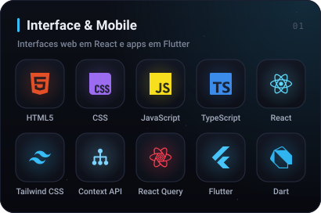
  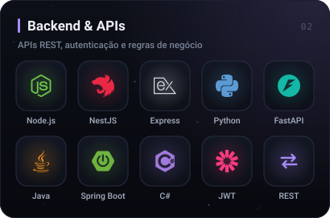

  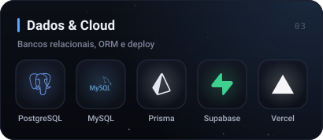
  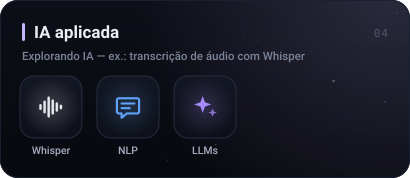

  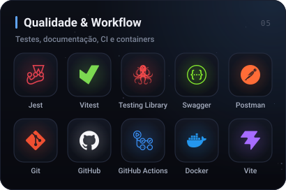
  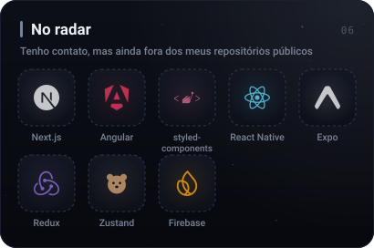

<!-- ═══════════════════════════ 04 · PROJETOS ═══════════════════════════ -->

  <picture>
    <source media="(prefers-color-scheme: light)" srcset="assets/sections/projetos-light.svg">
    
  </picture>

<!-- Cards compactos: cada card abre o repositório -->

  <a href="https://github.com/kaikehttps/library-api"></a>
  <a href="https://github.com/kaikehttps/HelpDesk"></a>

  <a href="https://github.com/kaikehttps/CloneSpotify"></a>
  <a href="https://github.com/kaikehttps/ControledeEstoque">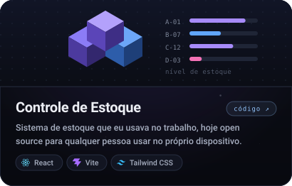</a>

  <a href="https://github.com/kaikehttps?tab=repositories">todos os repositórios ↗</a>

<!-- ═══════════════════════════ 05 · ATIVIDADE ═══════════════════════════
  Dados reais, gerados em tempo real pelos serviços (sem números fixos).
  "hide" esconde linguagens secundárias (shaders, CSS/HTML, build) para destacar as principais.
-->

  <picture>
    <source media="(prefers-color-scheme: light)" srcset="assets/sections/atividade-light.svg">
    
  </picture>

  
  

<!-- ═══════════════════════════ 06 · CONTATO ═══════════════════════════ -->

  <picture>
    <source media="(prefers-color-scheme: light)" srcset="assets/sections/contato-light.svg">
    
  </picture>

  <a href="https://github.com/kaikehttps">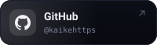</a>
  <a href="https://www.linkedin.com/in/kaikeferreiraalves/">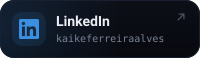</a>
  <a href="mailto:kaikebr208@gmail.com">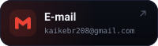</a>
  <a href="https://www.instagram.com/kaike_alvesz/">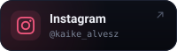</a>

 

<!-- Toque pessoal: os dois personagens favoritos, pequenos, antes do encerramento -->

  
  &nbsp;&nbsp;
  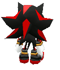
   
  Gengar &amp; Shadow · tripulação de bordo

<!-- ═══════════════════════════ RODAPÉ ═══════════════════════════ -->
<!-- EDITAR: a frase do rodapé fica dentro de assets/footer/footer.svg e footer-mobile.svg -->
<picture>
  <source media="(max-width: 600px)" srcset="assets/footer/footer-mobile.svg">
  
</picture>

<!--
  Créditos: fontes Space Grotesk e JetBrains Mono (SIL OFL 1.1) · ícones Simple Icons (CC0) e Devicon (MIT).
  Lista completa em assets/CREDITS.md.
-->
